# OpenGameArt: 2D art

**262 assets from [OpenGameArt](https://opengameart.org), dedicated to the public domain under [CC0](https://creativecommons.org/publicdomain/zero/1.0/).** Use them in any game, free or paid, and change them however you like; no credit is needed.

2D art from OpenGameArt entries licensed CC0 (some also offer other licences; CC0 is the one that applies here). 600.7 MB in all.

This is a copy kept by [zuujis-cc0](https://github.com/zuujis-cc0) so game makers can take single files from GitHub. It is not made by or affiliated with OpenGameArt: the originals, often in more formats and higher resolutions, are on [opengameart.org](https://opengameart.org). If they help you, consider [supporting OpenGameArt](https://opengameart.org/content/faq).

Every file is listed in [MANIFEST.tsv](MANIFEST.tsv) with its size and SHA-256. More free assets: [the Zuujis collection](https://github.com/zuujis-cc0/free-game-assets#readme).

| | | | |
| :-: | :-: | :-: | :-: |
| <a href="1-bit-platformer-pack-0">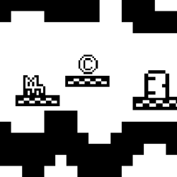</a> <b><a href="1-bit-platformer-pack-0">1-bit Platformer Pack</a></b> by ZaninDevelopers · <a href="https://opengameart.org/content/1-bit-platformer-pack-0">source</a> |  <b><a href="1-bit-robots-16x16">1 bit robots 16x16</a></b> by nightgane · <a href="https://opengameart.org/content/1-bit-robots-16x16">source</a> |  <b><a href="1-in-8-billion-%E2%80%93-free-life-simulator-life-milestone-icons-cc0-32x32">1 in 8 Billion – Free Life Simulator: life milestone icons (CC0, 32x32)</a></b> by onein8billion · <a href="https://opengameart.org/content/1-in-8-billion-%E2%80%93-free-life-simulator-life-milestone-icons-cc0-32x32">source</a> |  <b><a href="128x64-simple-little-slime">128x64 Simple Little Slime</a></b> by Diven GG · <a href="https://opengameart.org/content/128x64-simple-little-slime">source</a> |
| <a href="14-battle-backgrounds-from-monster-rpg-2-by-matthew-smith">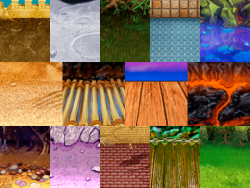</a> <b><a href="14-battle-backgrounds-from-monster-rpg-2-by-matthew-smith">14 Battle Backgrounds From Monster RPG 2 by Matthew Smith</a></b> by troutsneeze · <a href="https://opengameart.org/content/14-battle-backgrounds-from-monster-rpg-2-by-matthew-smith">source</a> | <a href="16x16-flies">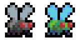</a> <b><a href="16x16-flies">16x16 Flies</a></b> by ARoachIFoundOnMyPillow · <a href="https://opengameart.org/content/16x16-flies">source</a> | <a href="16x16-grim-platformer-asset-pack-starlit-sanctuary">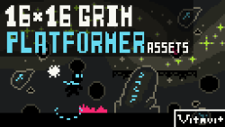</a> <b><a href="16x16-grim-platformer-asset-pack-starlit-sanctuary">16X16 Grim Platformer Asset Pack - Starlit Sanctuary</a></b> by VitaVit · <a href="https://opengameart.org/content/16x16-grim-platformer-asset-pack-starlit-sanctuary">source</a> | <a href="16x16-grim-platformer-assets-crystal-mines-pack">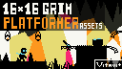</a> <b><a href="16x16-grim-platformer-assets-crystal-mines-pack">16x16 Grim Platformer Assets - Crystal mines pack</a></b> by VitaVit · <a href="https://opengameart.org/content/16x16-grim-platformer-assets-crystal-mines-pack">source</a> |
| <a href="16x16-item-and-weapon-tiles">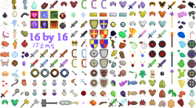</a> <b><a href="16x16-item-and-weapon-tiles">16x16 item and weapon tiles</a></b> by ChikenwingJJA · <a href="https://opengameart.org/content/16x16-item-and-weapon-tiles">source</a> | <a href="16x16-retro-sci-fi-pixel-art-sampler-pack-cc0">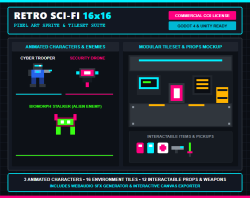</a> <b><a href="16x16-retro-sci-fi-pixel-art-sampler-pack-cc0">16x16 Retro Sci-Fi Pixel Art Sampler Pack (CC0)</a></b> by levshop · <a href="https://opengameart.org/content/16x16-retro-sci-fi-pixel-art-sampler-pack-cc0">source</a> | <a href="16x16-retro-sci-fi-pixel-art-sampler-pack-cc0-0">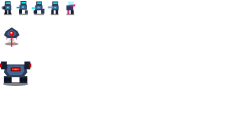</a> <b><a href="16x16-retro-sci-fi-pixel-art-sampler-pack-cc0-0">16x16 Retro Sci-Fi Pixel Art Sampler Pack (CC0)</a></b> by levshop · <a href="https://opengameart.org/content/16x16-retro-sci-fi-pixel-art-sampler-pack-cc0-0">source</a> | <a href="16x16-tileset-0">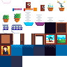</a> <b><a href="16x16-tileset-0">16x16 Tileset</a></b> by ThatGhzGamer · <a href="https://opengameart.org/content/16x16-tileset-0">source</a> |
|  <b><a href="16x16-torch">16x16 Torch</a></b> by Spring Spring · <a href="https://opengameart.org/content/16x16-torch">source</a> | <a href="200-tiny-buttons">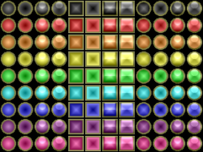</a> <b><a href="200-tiny-buttons">200+ Tiny Buttons</a></b> by Screaming Brain Studios · <a href="https://opengameart.org/content/200-tiny-buttons">source</a> | <a href="2bit-radio">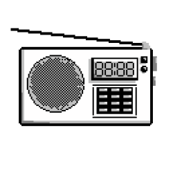</a> <b><a href="2bit-radio">2bit Radio</a></b> by ZaninDevelopers · <a href="https://opengameart.org/content/2bit-radio">source</a> |  <b><a href="2d-chess">2d Chess</a></b> by Lyricsz · <a href="https://opengameart.org/content/2d-chess">source</a> |
| <a href="2d-isometric-pixel-art-cave-tiles">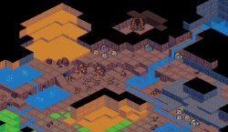</a> <b><a href="2d-isometric-pixel-art-cave-tiles">2d Isometric Pixel art Cave tiles</a></b> by Kipperfalcon · <a href="https://opengameart.org/content/2d-isometric-pixel-art-cave-tiles">source</a> | <a href="2d-magic-book">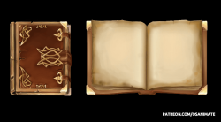</a> <b><a href="2d-magic-book">2d Magic Book</a></b> by osanimate · <a href="https://opengameart.org/content/2d-magic-book">source</a> | <a href="2d-monster-teeth">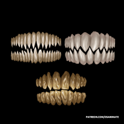</a> <b><a href="2d-monster-teeth">2d Monster Teeth</a></b> by osanimate · <a href="https://opengameart.org/content/2d-monster-teeth">source</a> | <a href="2d-pixel-art-gun-pack">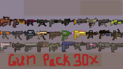</a> <b><a href="2d-pixel-art-gun-pack">2D Pixel Art Gun Pack</a></b> by Lyricsz · <a href="https://opengameart.org/content/2d-pixel-art-gun-pack">source</a> |
| <a href="2d-platformer-game-assets">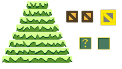</a> <b><a href="2d-platformer-game-assets">2D Platformer Game Assets</a></b> by mrochefort · <a href="https://opengameart.org/content/2d-platformer-game-assets">source</a> |  <b><a href="2d-puzzler-prototype-pixel">2D Puzzler Prototype Pixel</a></b> by Barnsbee · <a href="https://opengameart.org/content/2d-puzzler-prototype-pixel">source</a> |  <b><a href="2d-ufo">2d UFO</a></b> by osanimate · <a href="https://opengameart.org/content/2d-ufo">source</a> | <a href="3-different-textboxes">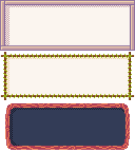</a> <b><a href="3-different-textboxes">3 Different Textboxes</a></b> by Pixel Archer · <a href="https://opengameart.org/content/3-different-textboxes">source</a> |
| <a href="300-glass-letter-tiles">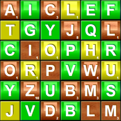</a> <b><a href="300-glass-letter-tiles">300+ Glass Letter Tiles</a></b> by Screaming Brain Studios · <a href="https://opengameart.org/content/300-glass-letter-tiles">source</a> | <a href="32x32-line-runes">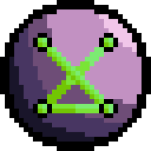</a> <b><a href="32x32-line-runes">32x32 Line Runes</a></b> by Bifrost Coalescence · <a href="https://opengameart.org/content/32x32-line-runes">source</a> | <a href="32x32-pixel-d6-dice-roll-results">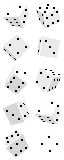</a> <b><a href="32x32-pixel-d6-dice-roll-results">32x32 pixel d6 dice roll & results</a></b> by adhochero · <a href="https://opengameart.org/content/32x32-pixel-d6-dice-roll-results">source</a> | <a href="380-isometric-crates">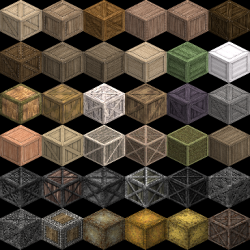</a> <b><a href="380-isometric-crates">380+ Isometric Crates</a></b> by Screaming Brain Studios · <a href="https://opengameart.org/content/380-isometric-crates">source</a> |
| <a href="4-important-looking-doors-128x128">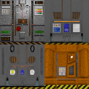</a> <b><a href="4-important-looking-doors-128x128">4 Important looking doors 128X128</a></b> by Puffolotti · <a href="https://opengameart.org/content/4-important-looking-doors-128x128">source</a> | <a href="512x512-explosion">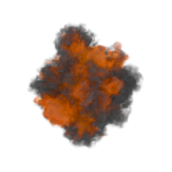</a> <b><a href="512x512-explosion">512x512 explosion</a></b> by johndekale · <a href="https://opengameart.org/content/512x512-explosion">source</a> | <a href="80s-arcade-tile-set">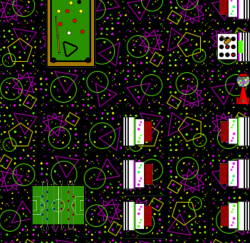</a> <b><a href="80s-arcade-tile-set">80s Arcade Tile Set</a></b> by RUOK · <a href="https://opengameart.org/content/80s-arcade-tile-set">source</a> | <a href="8x8-pixel-topdown-pack">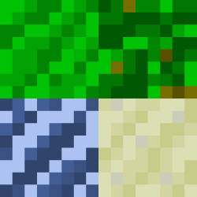</a> <b><a href="8x8-pixel-topdown-pack">8x8 Pixel Topdown Pack</a></b> by ZaninDevelopers · <a href="https://opengameart.org/content/8x8-pixel-topdown-pack">source</a> |
| <a href="8x8-sea-creatures">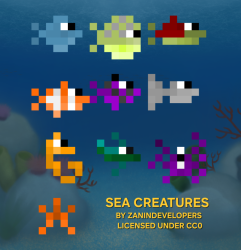</a> <b><a href="8x8-sea-creatures">8x8 Sea Creatures</a></b> by ZaninDevelopers · <a href="https://opengameart.org/content/8x8-sea-creatures">source</a> | <a href="8x8-sushi-sprites">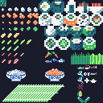</a> <b><a href="8x8-sushi-sprites">8x8 Sushi Sprites</a></b> by 1j01 · <a href="https://opengameart.org/content/8x8-sushi-sprites">source</a> | <a href="90s-cheese-celebration">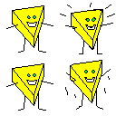</a> <b><a href="90s-cheese-celebration">90s Cheese Celebration</a></b> by pyranostudios · <a href="https://opengameart.org/content/90s-cheese-celebration">source</a> | <a href="a-background-sprite">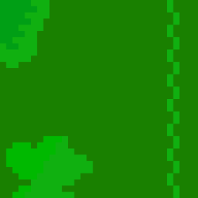</a> <b><a href="a-background-sprite">A background sprite</a></b> by EclipseDaOne · <a href="https://opengameart.org/content/a-background-sprite">source</a> |
| <a href="a-many-eyed-monster">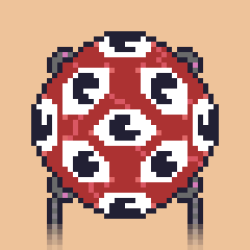</a> <b><a href="a-many-eyed-monster">a many-eyed monster</a></b> by ArVexi1050 · <a href="https://opengameart.org/content/a-many-eyed-monster">source</a> | <a href="alien-enemies-32x32">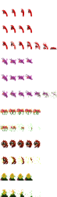</a> <b><a href="alien-enemies-32x32">Alien Enemies 32x32</a></b> by Gendgi · <a href="https://opengameart.org/content/alien-enemies-32x32">source</a> | <a href="alien-fingers-cursor">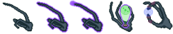</a> <b><a href="alien-fingers-cursor">Alien fingers cursor</a></b> by Tisroc · <a href="https://opengameart.org/content/alien-fingers-cursor">source</a> | <a href="alien-jar-hud">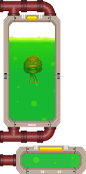</a> <b><a href="alien-jar-hud">Alien Jar Hud</a></b> by Paul Wortmann · <a href="https://opengameart.org/content/alien-jar-hud">source</a> |
| <a href="alien-trees-and-plants-for-climates-equivalent-to-earth-doom-palette-friendly">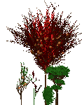</a> <b><a href="alien-trees-and-plants-for-climates-equivalent-to-earth-doom-palette-friendly">Alien trees and plants for climates equivalent to Earth (DooM palette friendly)</a></b> by Puffolotti · <a href="https://opengameart.org/content/alien-trees-and-plants-for-climates-equivalent-to-earth-doom-palette-friendly">source</a> | <a href="alphabet-bombs">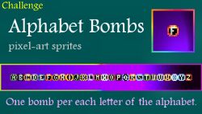</a> <b><a href="alphabet-bombs">Alphabet Bombs</a></b> by Reactorcore · <a href="https://opengameart.org/content/alphabet-bombs">source</a> | <a href="alternate-space-invaders">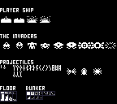</a> <b><a href="alternate-space-invaders">Alternate Space Invaders</a></b> by WaffleKilometer · <a href="https://opengameart.org/content/alternate-space-invaders">source</a> |  <b><a href="american-flag-250th-anniversary">American Flag 250th Anniversary</a></b> by ZaninDevelopers · <a href="https://opengameart.org/content/american-flag-250th-anniversary">source</a> |
| <a href="an-ouroboros-pixel-art">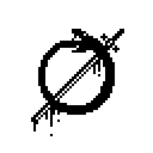</a> <b><a href="an-ouroboros-pixel-art">AN Ouroboros pixel art</a></b> by nightgane · <a href="https://opengameart.org/content/an-ouroboros-pixel-art">source</a> | <a href="animated-bomb-explosion">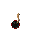</a> <b><a href="animated-bomb-explosion">Animated bomb explosion</a></b> by Bobjt · <a href="https://opengameart.org/content/animated-bomb-explosion">source</a> | <a href="animated-bone-hand-cursor">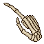</a> <b><a href="animated-bone-hand-cursor">Animated Bone Hand Cursor</a></b> by Tisroc · <a href="https://opengameart.org/content/animated-bone-hand-cursor">source</a> | <a href="animated-cc0-ships-v20">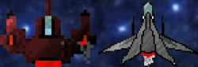</a> <b><a href="animated-cc0-ships-v20">Animated CC0 Ships v2.0</a></b> by ZaninDevelopers · <a href="https://opengameart.org/content/animated-cc0-ships-v20">source</a> |
| <a href="animated-cc0-space-ships">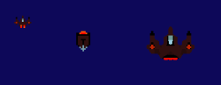</a> <b><a href="animated-cc0-space-ships">Animated CC0 Space Ships</a></b> by ZaninDevelopers · <a href="https://opengameart.org/content/animated-cc0-space-ships">source</a> | <a href="animated-creepy-ghost-sprite">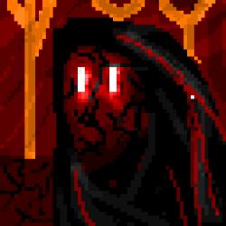</a> <b><a href="animated-creepy-ghost-sprite">Animated Creepy Ghost Sprite</a></b> by ZaninDevelopers · <a href="https://opengameart.org/content/animated-creepy-ghost-sprite">source</a> | <a href="animated-lofi-pixel-art-background-320x180">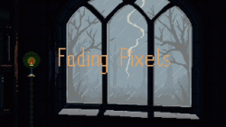</a> <b><a href="animated-lofi-pixel-art-background-320x180">Animated Lofi Pixel Art Background (320x180)</a></b> by jaymeehuynh · <a href="https://opengameart.org/content/animated-lofi-pixel-art-background-320x180">source</a> | <a href="animated-perspective-roadway">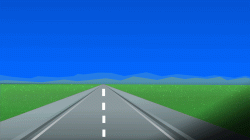</a> <b><a href="animated-perspective-roadway">Animated perspective roadway</a></b> by Technopeasant · <a href="https://opengameart.org/content/animated-perspective-roadway">source</a> |
|  <b><a href="approaching-meteor-animated">Approaching Meteor (Animated)</a></b> by ARoachIFoundOnMyPillow · <a href="https://opengameart.org/content/approaching-meteor-animated">source</a> | <a href="aquatic-creature-zibsesh">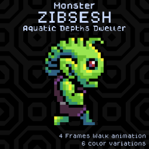</a> <b><a href="aquatic-creature-zibsesh">Aquatic Creature - Zibsesh</a></b> by ImogiaGames · <a href="https://opengameart.org/content/aquatic-creature-zibsesh">source</a> | <a href="assorted-powerups">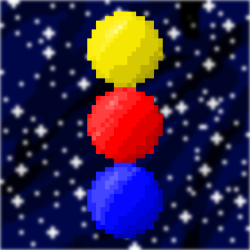</a> <b><a href="assorted-powerups">Assorted Powerups</a></b> by ZaninDevelopers · <a href="https://opengameart.org/content/assorted-powerups">source</a> |  <b><a href="assortment-of-pure-svg-art">Assortment of pure svg art</a></b> by Scalable Vector Shapes 2D · <a href="https://opengameart.org/content/assortment-of-pure-svg-art">source</a> |
| <a href="astronomia-deck">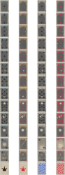</a> <b><a href="astronomia-deck">Astronomia Deck</a></b> by Mardeg · <a href="https://opengameart.org/content/astronomia-deck">source</a> | <a href="aztec-enemy-spritesheet">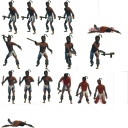</a> <b><a href="aztec-enemy-spritesheet">Aztec enemy spritesheet</a></b> by Kuvrot · <a href="https://opengameart.org/content/aztec-enemy-spritesheet">source</a> | <a href="background-assets-0">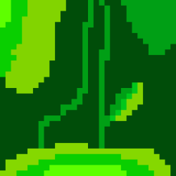</a> <b><a href="background-assets-0">Background Assets</a></b> by EclipseDaOne · <a href="https://opengameart.org/content/background-assets-0">source</a> | <a href="background-wire-tile-kit">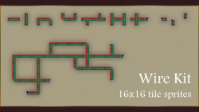</a> <b><a href="background-wire-tile-kit">Background Wire Tile Kit</a></b> by Reactorcore · <a href="https://opengameart.org/content/background-wire-tile-kit">source</a> |
|  <b><a href="bag-of-gold-coins">Bag of gold coins</a></b> by ArlanTR · <a href="https://opengameart.org/content/bag-of-gold-coins">source</a> |  <b><a href="bamboo-silhouette">Bamboo silhouette</a></b> by BunnyX · <a href="https://opengameart.org/content/bamboo-silhouette">source</a> |  <b><a href="basic-blue-comic-style-background-169">Basic Blue Comic Style Background (16:9)</a></b> by Supergamezzz · <a href="https://opengameart.org/content/basic-blue-comic-style-background-169">source</a> |  <b><a href="basic-character-template-2d">Basic character template 2d</a></b> by Meno.DM · <a href="https://opengameart.org/content/basic-character-template-2d">source</a> |
|  <b><a href="basic-rpg-icons">Basic Rpg Icons</a></b> by Pixel Archer · <a href="https://opengameart.org/content/basic-rpg-icons">source</a> |  <b><a href="battery-healthbar">battery healthbar</a></b> by archyman · <a href="https://opengameart.org/content/battery-healthbar">source</a> |  <b><a href="battery-icon">Battery Icon</a></b> by Joe Goomba · <a href="https://opengameart.org/content/battery-icon">source</a> |  <b><a href="beach-tileset">Beach tileset</a></b> by ChikenwingJJA · <a href="https://opengameart.org/content/beach-tileset">source</a> |
|  <b><a href="big-futuristic-weapons-for-mecha">Big Futuristic Weapons for Mecha</a></b> by Reactorcore · <a href="https://opengameart.org/content/big-futuristic-weapons-for-mecha">source</a> |  <b><a href="bird-asset">Bird asset</a></b> by EclipseDaOne · <a href="https://opengameart.org/content/bird-asset">source</a> |  <b><a href="bird-fly">Bird Fly</a></b> by draganasgamesart · <a href="https://opengameart.org/content/bird-fly">source</a> |  <b><a href="birds-0">Birds</a></b> by Spring Spring · <a href="https://opengameart.org/content/birds-0">source</a> |
|  <b><a href="black-and-white-4x8-tiles">black and white 4x8 tiles</a></b> by agdg reject · <a href="https://opengameart.org/content/black-and-white-4x8-tiles">source</a> |  <b><a href="blazes-platformer-pack-3-environments-included">blaze's Platformer Pack (3 Environments Included)</a></b> by blaze_xcvi · <a href="https://opengameart.org/content/blazes-platformer-pack-3-environments-included">source</a> |  <b><a href="blood-splatter-0">blood splatter</a></b> by hingydunyas · <a href="https://opengameart.org/content/blood-splatter-0">source</a> |  <b><a href="bloody-werewolf">Bloody Werewolf</a></b> by d36williams · <a href="https://opengameart.org/content/bloody-werewolf">source</a> |
|  <b><a href="blue-ball">Blue Ball</a></b> by Pixel Archer · <a href="https://opengameart.org/content/blue-ball">source</a> |  <b><a href="blue-cave-background">Blue Cave Background</a></b> by Spring Spring · <a href="https://opengameart.org/content/blue-cave-background">source</a> |  <b><a href="blue-guy-1">Blue Guy</a></b> by Alphahurricane · <a href="https://opengameart.org/content/blue-guy-1">source</a> |  <b><a href="book-icon-0">Book Icon</a></b> by Soloslime · <a href="https://opengameart.org/content/book-icon-0">source</a> |
|  <b><a href="box-sorters">Box Sorters</a></b> by Pixel Representation · <a href="https://opengameart.org/content/box-sorters">source</a> |  <b><a href="boxes-1">Boxes</a></b> by Pixel Representation · <a href="https://opengameart.org/content/boxes-1">source</a> |  <b><a href="boy-npc">Boy Npc</a></b> by Blind Harpy Gamedev · <a href="https://opengameart.org/content/boy-npc">source</a> |  <b><a href="bridge-sized-playing-card-deck-png-cc0">Bridge-Sized Playing Card Deck (PNG, CC0)</a></b> by Mesmedir · <a href="https://opengameart.org/content/bridge-sized-playing-card-deck-png-cc0">source</a> |
|  <b><a href="burning-background">Burning background</a></b> by mkwong98 · <a href="https://opengameart.org/content/burning-background">source</a> |  <b><a href="carpet-tileset">Carpet tileset</a></b> by bivouac95 · <a href="https://opengameart.org/content/carpet-tileset">source</a> |  <b><a href="cartoon-field-game-background">Cartoon Field Game Background</a></b> by Segel · <a href="https://opengameart.org/content/cartoon-field-game-background">source</a> |  <b><a href="cc0-arrows">CC0 Arrows</a></b> by knekko · <a href="https://opengameart.org/content/cc0-arrows">source</a> |
|  <b><a href="cc0-currency">CC0 Currency</a></b> by ZaninDevelopers · <a href="https://opengameart.org/content/cc0-currency">source</a> |  <b><a href="cc0-icon-spin">CC0 Icon Spin</a></b> by Ramza Pachi · <a href="https://opengameart.org/content/cc0-icon-spin">source</a> |  <b><a href="cc0-plant-clutter">CC0 Plant Clutter</a></b> by ZaninDevelopers · <a href="https://opengameart.org/content/cc0-plant-clutter">source</a> |  <b><a href="character-base-rpg-2d">Character Base RPG 2D</a></b> by nqxo · <a href="https://opengameart.org/content/character-base-rpg-2d">source</a> |
|  <b><a href="character-comandos">character comandos</a></b> by khaledpng · <a href="https://opengameart.org/content/character-comandos">source</a> |  <b><a href="checkbox-ui-1990s">Checkbox UI (1990s)</a></b> by pyranostudios · <a href="https://opengameart.org/content/checkbox-ui-1990s">source</a> |  <b><a href="cheese-bunker">Cheese Bunker</a></b> by Spring Spring · <a href="https://opengameart.org/content/cheese-bunker">source</a> |  <b><a href="chests-3">chests</a></b> by gamemaker_goody9090 · <a href="https://opengameart.org/content/chests-3">source</a> |
|  <b><a href="chill-boy-character">Chill Boy Character</a></b> by Segel · <a href="https://opengameart.org/content/chill-boy-character">source</a> |  <b><a href="chinese-green-dragon">Chinese Green Dragon</a></b> by Pixel Archer · <a href="https://opengameart.org/content/chinese-green-dragon">source</a> |  <b><a href="chinese-icons">Chinese Icons</a></b> by Pixel Archer · <a href="https://opengameart.org/content/chinese-icons">source</a> |  <b><a href="circuit-spritesheet-pixelart">Circuit spritesheet pixelart</a></b> by wender · <a href="https://opengameart.org/content/circuit-spritesheet-pixelart">source</a> |
|  <b><a href="circuitboard">Circuitboard</a></b> by ArtBIT · <a href="https://opengameart.org/content/circuitboard">source</a> |  <b><a href="classic-4-color-poker-deck-svg">Classic 4-Color Poker Deck (SVG)</a></b> by Heratexx · <a href="https://opengameart.org/content/classic-4-color-poker-deck-svg">source</a> |  <b><a href="clock-1">Clock</a></b> by BurtonX4 · <a href="https://opengameart.org/content/clock-1">source</a> |  <b><a href="cloisters-deck">Cloisters Deck</a></b> by Mardeg · <a href="https://opengameart.org/content/cloisters-deck">source</a> |
|  <b><a href="cloudy-skyboxes-0">Cloudy Skyboxes</a></b> by Screaming Brain Studios · <a href="https://opengameart.org/content/cloudy-skyboxes-0">source</a> |  <b><a href="coffee-run">Coffee Run</a></b> by simranzenov · <a href="https://opengameart.org/content/coffee-run">source</a> |  <b><a href="coins-1">Coins</a></b> by johndekale · <a href="https://opengameart.org/content/coins-1">source</a> |  <b><a href="colored-animated-robots-professor-chaos">Colored & "Animated" Robots & Professor Chaos</a></b> by byte21516 · <a href="https://opengameart.org/content/colored-animated-robots-professor-chaos">source</a> |
|  <b><a href="colored-number-buttons-01-99">Colored Number-Buttons (01-99)</a></b> by DreyArts · <a href="https://opengameart.org/content/colored-number-buttons-01-99">source</a> |  <b><a href="computer-gibber-inspection-panels-stairs-transition-elements">Computer gibber, inspection panels, stairs, transition elements</a></b> by Puffolotti · <a href="https://opengameart.org/content/computer-gibber-inspection-panels-stairs-transition-elements">source</a> |  <b><a href="computer-parts-quest-items">Computer parts (Quest items)</a></b> by KillGorack · <a href="https://opengameart.org/content/computer-parts-quest-items">source</a> |  <b><a href="connect-4-aka-4-in-a-row-2d-graphics">Connect-4 aka 4-in-a-row 2D graphics</a></b> by BdRGames · <a href="https://opengameart.org/content/connect-4-aka-4-in-a-row-2d-graphics">source</a> |
|  <b><a href="construction-box-to-assemble-pipes-grids-or-to-decorate-backgrounds">construction box to assemble pipes grids or to decorate backgrounds</a></b> by Puffolotti · <a href="https://opengameart.org/content/construction-box-to-assemble-pipes-grids-or-to-decorate-backgrounds">source</a> |  <b><a href="core-reactor-machines">Core Reactor Machines</a></b> by Reactorcore · <a href="https://opengameart.org/content/core-reactor-machines">source</a> |  <b><a href="corrupted-metropolitan-angel-face-portraits">Corrupted metropolitan angel face portraits</a></b> by Cawfeecrow · <a href="https://opengameart.org/content/corrupted-metropolitan-angel-face-portraits">source</a> |  <b><a href="crate-box">Crate Box</a></b> by FunnyDude · <a href="https://opengameart.org/content/crate-box">source</a> |
|  <b><a href="crosshair-triple-super-pack-32px">Crosshair Triple Super Pack 32px</a></b> by Reactorcore · <a href="https://opengameart.org/content/crosshair-triple-super-pack-32px">source</a> |  <b><a href="crystals-2">Crystals</a></b> by SpiderDave · <a href="https://opengameart.org/content/crystals-2">source</a> |  <b><a href="cute-cat-32x32">Cute cat (32x32)</a></b> by limafresh · <a href="https://opengameart.org/content/cute-cat-32x32">source</a> |  <b><a href="cute-ducky-duck-character">Cute Ducky Duck Character</a></b> by Segel · <a href="https://opengameart.org/content/cute-ducky-duck-character">source</a> |
|  <b><a href="cute-food-sprites">Cute Food Sprites</a></b> by cwendeku · <a href="https://opengameart.org/content/cute-food-sprites">source</a> |  <b><a href="cute-penguin-character">Cute Penguin Character</a></b> by Segel · <a href="https://opengameart.org/content/cute-penguin-character">source</a> |  <b><a href="cute-polar-bear-character">Cute Polar Bear Character</a></b> by Segel · <a href="https://opengameart.org/content/cute-polar-bear-character">source</a> |  <b><a href="cute-reindeer-character">Cute Reindeer Character</a></b> by Segel · <a href="https://opengameart.org/content/cute-reindeer-character">source</a> |
|  <b><a href="dark-realm-tileset">Dark Realm tileset</a></b> by ChikenwingJJA · <a href="https://opengameart.org/content/dark-realm-tileset">source</a> |  <b><a href="definitely-not-models-portrait-collection">Definitely not models portrait collection</a></b> by Some Weirdo · <a href="https://opengameart.org/content/definitely-not-models-portrait-collection">source</a> |  <b><a href="dessert-treat-sprites">dessert treat sprites</a></b> by elfy_boo · <a href="https://opengameart.org/content/dessert-treat-sprites">source</a> |  <b><a href="dice-5">Dice</a></b> by Touzi · <a href="https://opengameart.org/content/dice-5">source</a> |
|  <b><a href="different-colored-gems">Different Colored Gems</a></b> by Pixel Archer · <a href="https://opengameart.org/content/different-colored-gems">source</a> |  <b><a href="dinosaurs">Dinosaurs</a></b> by ARoachIFoundOnMyPillow · <a href="https://opengameart.org/content/dinosaurs">source</a> |  <b><a href="dog-spritesheets">Dog Spritesheets</a></b> by Jason of GDN · <a href="https://opengameart.org/content/dog-spritesheets">source</a> |  <b><a href="donuts-20x">Donuts (20x)</a></b> by Lyricsz · <a href="https://opengameart.org/content/donuts-20x">source</a> |
|  <b><a href="dr-doktor">Dr. Doktor</a></b> by knekko · <a href="https://opengameart.org/content/dr-doktor">source</a> |  <b><a href="dragon-head-symbol">Dragon Head Symbol</a></b> by Oyasumi · <a href="https://opengameart.org/content/dragon-head-symbol">source</a> |  <b><a href="duality-font">Duality (font)</a></b> by korin · <a href="https://opengameart.org/content/duality-font">source</a> |  <b><a href="dwarf-miner-run">Dwarf miner run</a></b> by woodsmoke · <a href="https://opengameart.org/content/dwarf-miner-run">source</a> |
|  <b><a href="egyptian-bubble-mage">Egyptian Bubble Mage</a></b> by Pixel Archer · <a href="https://opengameart.org/content/egyptian-bubble-mage">source</a> |  <b><a href="elixir-and-soda-tilemap">Elixir and Soda Tilemap</a></b> by BunnyX · <a href="https://opengameart.org/content/elixir-and-soda-tilemap">source</a> |  <b><a href="emojis">Emoji's</a></b> by Pro Sensory · <a href="https://opengameart.org/content/emojis">source</a> |  <b><a href="enemy-sprite-0">Enemy Sprite</a></b> by Teapot · <a href="https://opengameart.org/content/enemy-sprite-0">source</a> |
|  <b><a href="eradication-wars-weapon-sprite-pack">Eradication Wars Weapon Sprite Pack</a></b> by Reactorcore · <a href="https://opengameart.org/content/eradication-wars-weapon-sprite-pack">source</a> |  <b><a href="everface">EverFace</a></b> by Efilheim · <a href="https://opengameart.org/content/everface">source</a> |  <b><a href="explosion-10">explosion</a></b> by johndekale · <a href="https://opengameart.org/content/explosion-10">source</a> |  <b><a href="fantasy-rpg-icons-0">Fantasy RPG Icons</a></b> by Drummyfish · <a href="https://opengameart.org/content/fantasy-rpg-icons-0">source</a> |
|  <b><a href="fantasy-rpg-icons-2">Fantasy RPG Icons 2</a></b> by Drummyfish · <a href="https://opengameart.org/content/fantasy-rpg-icons-2">source</a> |  <b><a href="fantasy-rpg-icons-3">Fantasy RPG Icons 3</a></b> by Drummyfish · <a href="https://opengameart.org/content/fantasy-rpg-icons-3">source</a> |  <b><a href="feather-grayscale-transition-image">Feather grayscale transition image</a></b> by hatmix · <a href="https://opengameart.org/content/feather-grayscale-transition-image">source</a> |  <b><a href="feathers">Feathers</a></b> by syntactics · <a href="https://opengameart.org/content/feathers">source</a> |
|  <b><a href="fever-dream-faces">Fever Dream Faces</a></b> by knekko · <a href="https://opengameart.org/content/fever-dream-faces">source</a> |  <b><a href="fire-smoke-animations">Fire Smoke Animations</a></b> by Reactorcore · <a href="https://opengameart.org/content/fire-smoke-animations">source</a> |  <b><a href="fish-db32">Fish (DB32)</a></b> by ARoachIFoundOnMyPillow · <a href="https://opengameart.org/content/fish-db32">source</a> |  <b><a href="flame-knight">Flame Knight</a></b> by arzaaa · <a href="https://opengameart.org/content/flame-knight">source</a> |
|  <b><a href="flappy-bird-assets">Flappy Bird Assets</a></b> by mujtaba-io · <a href="https://opengameart.org/content/flappy-bird-assets">source</a> |  <b><a href="flappy-sprite-sheet-16x16">Flappy Sprite Sheet 16x16</a></b> by yorokobi-games · <a href="https://opengameart.org/content/flappy-sprite-sheet-16x16">source</a> |  <b><a href="flash-mage">Flash Mage</a></b> by Some Weirdo · <a href="https://opengameart.org/content/flash-mage">source</a> |  <b><a href="floating-crocodile">Floating Crocodile</a></b> by ShggothSlave · <a href="https://opengameart.org/content/floating-crocodile">source</a> |
|  <b><a href="flopper-frogger-sprites">Flopper (Frogger) sprites</a></b> by WaffleKilometer · <a href="https://opengameart.org/content/flopper-frogger-sprites">source</a> |  <b><a href="flora-deck">Flora Deck</a></b> by Mardeg · <a href="https://opengameart.org/content/flora-deck">source</a> |  <b><a href="flower-textures-for-low-poly-games">Flower Textures for low poly games</a></b> by acteroly · <a href="https://opengameart.org/content/flower-textures-for-low-poly-games">source</a> |  <b><a href="food-pack-16x16">Food Pack 16x16</a></b> by Kipperfalcon · <a href="https://opengameart.org/content/food-pack-16x16">source</a> |
|  <b><a href="forest-troll">Forest troll</a></b> by Blind Harpy Gamedev · <a href="https://opengameart.org/content/forest-troll">source</a> |  <b><a href="fox-1">Fox</a></b> by Pixel Archer · <a href="https://opengameart.org/content/fox-1">source</a> |  <b><a href="foxwing-starfighter">Foxwing Starfighter</a></b> by Reactorcore · <a href="https://opengameart.org/content/foxwing-starfighter">source</a> |  <b><a href="fps-weapons-overlay">FPS Weapons Overlay</a></b> by knekko · <a href="https://opengameart.org/content/fps-weapons-overlay">source</a> |
|  <b><a href="free-forest-isometric-pixel-art">[FREE] Forest Isometric Pixel art.</a></b> by Kipperfalcon · <a href="https://opengameart.org/content/free-forest-isometric-pixel-art">source</a> |  <b><a href="free-game-art">Free Game Art</a></b> by frizck_fARTist · <a href="https://opengameart.org/content/free-game-art">source</a> |  <b><a href="free-isometric-pixel-art-luxury-sedan-car">Free Isometric Pixel Art Luxury Sedan Car</a></b> by khaledpng · <a href="https://opengameart.org/content/free-isometric-pixel-art-luxury-sedan-car">source</a> |  <b><a href="free-sample-16x16-pixel-forest-animal-pack-%E2%80%93-top-down-rpg-style">[Free Sample] 16x16 Pixel Forest Animal Pack – Top-down RPG Style</a></b> by inkBubi · <a href="https://opengameart.org/content/free-sample-16x16-pixel-forest-animal-pack-%E2%80%93-top-down-rpg-style">source</a> |
|  <b><a href="free-sample-16x16-pixel-forest-tileset-%E2%80%93-top-down-rpg-style">[Free Sample] 16x16 Pixel Forest Tileset – Top-down RPG Style</a></b> by inkBubi · <a href="https://opengameart.org/content/free-sample-16x16-pixel-forest-tileset-%E2%80%93-top-down-rpg-style">source</a> |  <b><a href="free-space-isometric-pixel-art">[FREE] Space Isometric Pixel art</a></b> by Kipperfalcon · <a href="https://opengameart.org/content/free-space-isometric-pixel-art">source</a> |  <b><a href="frog">Frog</a></b> by Pixel Archer · <a href="https://opengameart.org/content/frog">source</a> |  <b><a href="frog-jump">Frog Jump</a></b> by draganasgamesart · <a href="https://opengameart.org/content/frog-jump">source</a> |
|  <b><a href="funny-no-ticks-anti-ticks-88x31-button">Funny No Ticks / Anti-Ticks 88x31 button</a></b> by nightgane · <a href="https://opengameart.org/content/funny-no-ticks-anti-ticks-88x31-button">source</a> |  <b><a href="future-city-27">Future City 27</a></b> by knekko · <a href="https://opengameart.org/content/future-city-27">source</a> |  <b><a href="futuristic-guns-weapons-and-items">Futuristic Guns, Weapons and Items</a></b> by knekko · <a href="https://opengameart.org/content/futuristic-guns-weapons-and-items">source</a> |  <b><a href="gate-1">Gate</a></b> by draganasgamesart · <a href="https://opengameart.org/content/gate-1">source</a> |
|  <b><a href="generic-denizens">Generic Denizens</a></b> by Some Weirdo · <a href="https://opengameart.org/content/generic-denizens">source</a> |  <b><a href="ghost-sprite-0">Ghost sprite</a></b> by EclipseDaOne · <a href="https://opengameart.org/content/ghost-sprite-0">source</a> |  <b><a href="gingerbread">Gingerbread</a></b> by limafresh · <a href="https://opengameart.org/content/gingerbread">source</a> |  <b><a href="girl-top-down">girl top-down</a></b> by allen yatsura · <a href="https://opengameart.org/content/girl-top-down">source</a> |
|  <b><a href="goblin-encounter-splash-page">Goblin Encounter Splash Page</a></b> by Some Weirdo · <a href="https://opengameart.org/content/goblin-encounter-splash-page">source</a> |  <b><a href="gold-chick">Gold Chick</a></b> by Pixel Archer · <a href="https://opengameart.org/content/gold-chick">source</a> |  <b><a href="good-cc0-pixel-game-backgrounds">Good CC0 Pixel Game Backgrounds</a></b> by ZaninDevelopers · <a href="https://opengameart.org/content/good-cc0-pixel-game-backgrounds">source</a> |  <b><a href="gore-blood-gibs-meat-chunks">Gore Blood Gibs Meat Chunks</a></b> by Reactorcore · <a href="https://opengameart.org/content/gore-blood-gibs-meat-chunks">source</a> |
|  <b><a href="graviton-beam-emitter">Graviton Beam Emitter</a></b> by Reactorcore · <a href="https://opengameart.org/content/graviton-beam-emitter">source</a> |  <b><a href="green-pipe">Green pipe</a></b> by limafresh · <a href="https://opengameart.org/content/green-pipe">source</a> |  <b><a href="groud-sprite-for-free">Groud Sprite For Free</a></b> by EclipseDaOne · <a href="https://opengameart.org/content/groud-sprite-for-free">source</a> |  <b><a href="ground-asset">Ground Asset</a></b> by EclipseDaOne · <a href="https://opengameart.org/content/ground-asset">source</a> |
|  <b><a href="grw-nuke-launcher-antinuke-launcher">GRW Nuke Launcher && Antinuke Launcher</a></b> by Fepsid · <a href="https://opengameart.org/content/grw-nuke-launcher-antinuke-launcher">source</a> |  <b><a href="grw-scout">GRW Scout</a></b> by Fepsid · <a href="https://opengameart.org/content/grw-scout">source</a> |  <b><a href="grw-tank">GRW Tank</a></b> by Fepsid · <a href="https://opengameart.org/content/grw-tank">source</a> |  <b><a href="gui-pack-1">GUI pack</a></b> by Soliforx · <a href="https://opengameart.org/content/gui-pack-1">source</a> |
|  <b><a href="gun-muzzle-flash-effects-fire-and-ion-and-melee">Gun Muzzle Flash Effects (Fire and Ion and Melee)</a></b> by Reactorcore · <a href="https://opengameart.org/content/gun-muzzle-flash-effects-fire-and-ion-and-melee">source</a> |  <b><a href="gunman-wearing-a-cap">Gunman wearing a cap</a></b> by bruhfrom2012 · <a href="https://opengameart.org/content/gunman-wearing-a-cap">source</a> |  <b><a href="guns-2d-prototype-asset-pack">Gun's 2D Prototype Asset Pack</a></b> by Pythonesqi · <a href="https://opengameart.org/content/guns-2d-prototype-asset-pack">source</a> |  <b><a href="hachi-bases">Hachi Bases</a></b> by Technopeasant · <a href="https://opengameart.org/content/hachi-bases">source</a> |
|  <b><a href="haetae">Haetae</a></b> by Pixel Archer · <a href="https://opengameart.org/content/haetae">source</a> |  <b><a href="halloween-pumpkins">Halloween Pumpkins</a></b> by Viergacht · <a href="https://opengameart.org/content/halloween-pumpkins">source</a> |  <b><a href="handle-button">Handle Button</a></b> by draganasgamesart · <a href="https://opengameart.org/content/handle-button">source</a> |  <b><a href="happy-little-flowers">Happy Little Flowers</a></b> by Ragnar Random · <a href="https://opengameart.org/content/happy-little-flowers">source</a> |
|  <b><a href="health-bars-pack">health bars pack</a></b> by archyman · <a href="https://opengameart.org/content/health-bars-pack">source</a> |  <b><a href="healthbar-sprite">Healthbar sprite</a></b> by ArtBIT · <a href="https://opengameart.org/content/healthbar-sprite">source</a> |  <b><a href="healthbar-sprite-0">Healthbar sprite</a></b> by ArtBIT · <a href="https://opengameart.org/content/healthbar-sprite-0">source</a> |  <b><a href="heart-bar">Heart Bar</a></b> by ArtBIT · <a href="https://opengameart.org/content/heart-bar">source</a> |
|  <b><a href="hearts-0">Hearts</a></b> by Lyricsz · <a href="https://opengameart.org/content/hearts-0">source</a> |  <b><a href="heavy-cargo-transport-dropship-aircraft">Heavy Cargo Transport Dropship Aircraft</a></b> by Reactorcore · <a href="https://opengameart.org/content/heavy-cargo-transport-dropship-aircraft">source</a> |  <b><a href="hex-outlines-tilemap-sheet">Hex Outlines Tilemap Sheet</a></b> by simeonradivoev · <a href="https://opengameart.org/content/hex-outlines-tilemap-sheet">source</a> |  <b><a href="high-tech-combat-vehicle-heavy-battle-tank">High Tech Combat Vehicle Heavy Battle Tank</a></b> by Reactorcore · <a href="https://opengameart.org/content/high-tech-combat-vehicle-heavy-battle-tank">source</a> |
|  <b><a href="high-tech-combat-vehicles-aerial">High Tech Combat Vehicles Aerial</a></b> by Reactorcore · <a href="https://opengameart.org/content/high-tech-combat-vehicles-aerial">source</a> |  <b><a href="high-tech-combat-vehicles-ground">High Tech Combat Vehicles Ground</a></b> by Reactorcore · <a href="https://opengameart.org/content/high-tech-combat-vehicles-ground">source</a> |  <b><a href="house-assets-pack">House Assets Pack</a></b> by Lyricsz · <a href="https://opengameart.org/content/house-assets-pack">source</a> |  <b><a href="idylwilds-runic-codex">Idylwild's Runic Codex</a></b> by Idylwild · <a href="https://opengameart.org/content/idylwilds-runic-codex">source</a> |
|  <b><a href="iso-spider-spritesheet">ISO Spider spritesheet</a></b> by KillGorack · <a href="https://opengameart.org/content/iso-spider-spritesheet">source</a> |  <b><a href="iso-spritesheet">ISO Spritesheet</a></b> by KillGorack · <a href="https://opengameart.org/content/iso-spritesheet">source</a> |  <b><a href="isometric-buildings-2">Isometric buildings</a></b> by Soliforx · <a href="https://opengameart.org/content/isometric-buildings-2">source</a> |  <b><a href="isometric-fast-food-building">Isometric Fast Food Building</a></b> by khaledpng · <a href="https://opengameart.org/content/isometric-fast-food-building">source</a> |
|  <b><a href="isometric-symphony-players">Isometric Symphony Players</a></b> by CodyS · <a href="https://opengameart.org/content/isometric-symphony-players">source</a> |  <b><a href="isometric-village-builder">Isometric Village Builder</a></b> by khaledpng · <a href="https://opengameart.org/content/isometric-village-builder">source</a> |  <b><a href="isometric-world-tiles">Isometric world tiles</a></b> by Soliforx · <a href="https://opengameart.org/content/isometric-world-tiles">source</a> |  <b><a href="jack-o-lantern-pumpkin">Jack o lantern pumpkin</a></b> by pyranostudios · <a href="https://opengameart.org/content/jack-o-lantern-pumpkin">source</a> |
|  <b><a href="japanese-style-simple-backgrounds">Japanese style simple backgrounds</a></b> by Oyasumi · <a href="https://opengameart.org/content/japanese-style-simple-backgrounds">source</a> |  <b><a href="jem-sprites-animated-classic-hero-edit">JEM Sprites [Animated] - Classic Hero Edit</a></b> by Umz · <a href="https://opengameart.org/content/jem-sprites-animated-classic-hero-edit">source</a> |  <b><a href="kamaitachi">Kamaitachi</a></b> by Pixel Archer · <a href="https://opengameart.org/content/kamaitachi">source</a> |  <b><a href="knife-for-a-25d-fps">knife for a 2.5d fps</a></b> by Spiodude · <a href="https://opengameart.org/content/knife-for-a-25d-fps">source</a> |
|  <b><a href="knight-princess-and-dragon-2">Knight, Princess and Dragon 2</a></b> by akylrum · <a href="https://opengameart.org/content/knight-princess-and-dragon-2">source</a> |  <b><a href="kung-fu-battlers-pixel-art">Kung Fu Battlers pixel art</a></b> by CodyS · <a href="https://opengameart.org/content/kung-fu-battlers-pixel-art">source</a> |  <b><a href="lamps-lights-n-torches">Lamps Lights n Torches</a></b> by Reactorcore · <a href="https://opengameart.org/content/lamps-lights-n-torches">source</a> |  <b><a href="lanky-character-man">Lanky Character (Man)</a></b> by Fawas Interactive · <a href="https://opengameart.org/content/lanky-character-man">source</a> |
|  <b><a href="lava-waves">Lava Waves</a></b> by StalwartBlue · <a href="https://opengameart.org/content/lava-waves">source</a> |  <b><a href="lazer-zero">Lazer Zero</a></b> by ciatgepete · <a href="https://opengameart.org/content/lazer-zero">source</a> |  <b><a href="letter-text-marking-symbols">Letter Text Marking Symbols</a></b> by Reactorcore · <a href="https://opengameart.org/content/letter-text-marking-symbols">source</a> |  <b><a href="lever-and-button">Lever and Button</a></b> by FunnyDude · <a href="https://opengameart.org/content/lever-and-button">source</a> |
|  <b><a href="lil-monster-guy">Lil' Monster Guy</a></b> by ThatGhzGamer · <a href="https://opengameart.org/content/lil-monster-guy">source</a> |  <b><a href="little-alien-sprite-sheet">Little alien sprite sheet</a></b> by Soliforx · <a href="https://opengameart.org/content/little-alien-sprite-sheet">source</a> |  <b><a href="logs-pack">Logs pack</a></b> by limafresh · <a href="https://opengameart.org/content/logs-pack">source</a> |  <b><a href="lores-32x-tiles">Lore's 32x Tiles</a></b> by deepest_lore · <a href="https://opengameart.org/content/lores-32x-tiles">source</a> |
|  <b><a href="lpc-candyland">LPC Candyland</a></b> by Blue Moon Bear · <a href="https://opengameart.org/content/lpc-candyland">source</a> |  <b><a href="lpc-modern-streets">LPC Modern Streets</a></b> by Faufilage · <a href="https://opengameart.org/content/lpc-modern-streets">source</a> |  <b><a href="lpc-shotgun-animation-and-icon">LPC Shotgun Animation and Icon</a></b> by blancaster45 · <a href="https://opengameart.org/content/lpc-shotgun-animation-and-icon">source</a> |  <b><a href="man-in-coveralls">Man in Coveralls</a></b> by Technopeasant · <a href="https://opengameart.org/content/man-in-coveralls">source</a> |
|  <b><a href="mannequin-model">Mannequin Model</a></b> by Pixel Representation · <a href="https://opengameart.org/content/mannequin-model">source</a> |  <b><a href="manyak-bebis-spritesheet">Manyak Bebis SpriteSheet</a></b> by bebis · <a href="https://opengameart.org/content/manyak-bebis-spritesheet">source</a> |  <b><a href="meca-dog">Meca Dog</a></b> by Blind Harpy Gamedev · <a href="https://opengameart.org/content/meca-dog">source</a> |  <b><a href="mechanized-magic-2d-vector-cards-pack">Mechanized Magic: 2D Vector Cards Pack</a></b> by Dumivid · <a href="https://opengameart.org/content/mechanized-magic-2d-vector-cards-pack">source</a> |
|  <b><a href="mechanized-magic-ultimate-ui-pack">Mechanized Magic: Ultimate UI Pack</a></b> by Dumivid · <a href="https://opengameart.org/content/mechanized-magic-ultimate-ui-pack">source</a> |  <b><a href="medicine-pack-16x16">Medicine Pack 16x16</a></b> by Kipperfalcon · <a href="https://opengameart.org/content/medicine-pack-16x16">source</a> |  <b><a href="medieval-citizens-vol1-%E2%80%94-free-sample-farmer-down-direction">Medieval Citizens Vol.1 — Free Sample (Farmer, Down Direction)</a></b> by hnnnnnnn · <a href="https://opengameart.org/content/medieval-citizens-vol1-%E2%80%94-free-sample-farmer-down-direction">source</a> |  <b><a href="medieval-ser%D1%B5ices-vol1-free-sample-1-character-down-direction">Medieval Serѵices Vol.1 - Free Sample (1 Character, Down Direction)</a></b> by hnnnnnnn · <a href="https://opengameart.org/content/medieval-ser%D1%B5ices-vol1-free-sample-1-character-down-direction">source</a> |
|  <b><a href="meditator">Meditator</a></b> by zwonky · <a href="https://opengameart.org/content/meditator">source</a> |  <b><a href="melee-bludgeon-blade-weapons">Melee Bludgeon Blade Weapons</a></b> by Reactorcore · <a href="https://opengameart.org/content/melee-bludgeon-blade-weapons">source</a> |  <b><a href="mine-game-graphics">Mine Game Graphics</a></b> by howeverice · <a href="https://opengameart.org/content/mine-game-graphics">source</a> |  <b><a href="mini-gameboy-platformer-pack">Mini Gameboy Platformer Pack</a></b> by Fava Beans · <a href="https://opengameart.org/content/mini-gameboy-platformer-pack">source</a> |
|  <b><a href="monster-plant">monster plant</a></b> by ArVexi1050 · <a href="https://opengameart.org/content/monster-plant">source</a> |  <b><a href="monsters-of-nature-all-pack">Monsters of nature | All Pack</a></b> by qwerty2723 · <a href="https://opengameart.org/content/monsters-of-nature-all-pack">source</a> |  <b><a href="more-blocks">More Blocks</a></b> by ARoachIFoundOnMyPillow · <a href="https://opengameart.org/content/more-blocks">source</a> |  <b><a href="more-simple-tiles">More simple tiles</a></b> by ChikenwingJJA · <a href="https://opengameart.org/content/more-simple-tiles">source</a> |
|  <b><a href="motocross-trial-motorcycle-dirtbike">Motocross Trial Motorcycle Dirtbike</a></b> by Reactorcore · <a href="https://opengameart.org/content/motocross-trial-motorcycle-dirtbike">source</a> |  <b><a href="mouth-monster">mouth monster</a></b> by woodsmoke · <a href="https://opengameart.org/content/mouth-monster">source</a> |  <b><a href="mrs-man">Mrs. Man</a></b> by knekko · <a href="https://opengameart.org/content/mrs-man">source</a> |  <b><a href="mushroom-pixel-art-pack-32x32-free-game-assets">Mushroom Pixel Art Pack - 32x32 (Free Game Assets)</a></b> by peterfield2006 · <a href="https://opengameart.org/content/mushroom-pixel-art-pack-32x32-free-game-assets">source</a> |
|  <b><a href="my-random-japanese-pixel-art">My random Japanese pixel art</a></b> by Yakhmet · <a href="https://opengameart.org/content/my-random-japanese-pixel-art">source</a> |  <b><a href="mysterious-contraption">Mysterious Contraption</a></b> by KobatoGames · <a href="https://opengameart.org/content/mysterious-contraption">source</a> |  |  |

---

Kept up to date by this repository's own [update workflow](.github/workflows/update.yml), with code and plan from [cc0-mirror](https://github.com/zuujis-cc0/cc0-mirror). Something wrong? [Open an issue there](https://github.com/zuujis-cc0/cc0-mirror/issues/new) or use the [private report form](https://games.zuujis.com/report).
